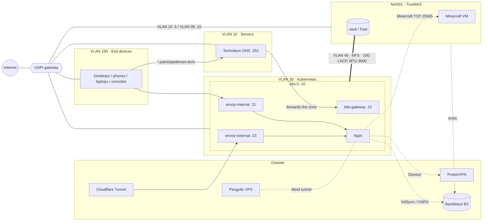

# ⛵ home-ops

GitOps repository for my homelab: a single-node [Talos](https://www.talos.dev) Kubernetes cluster managed by [Flux](https://fluxcd.io), with a [TrueNAS](https://www.truenas.com) box for storage. Started from [onedr0p/cluster-template](https://github.com/onedr0p/cluster-template); [Renovate](https://www.mend.io/renovate) keeps everything up to date.

## 🖥️ Hardware

| Host    | Role                                     | Notes                                                                                  |
| ------- | ---------------------------------------- | -------------------------------------------------------------------------------------- |
| `k8s-0` | Talos control plane + workloads          | Intel (QSV for Jellyfin), SecureBoot/TPM, encrypted disk, LACP storage bond (MTU 9000) |
| `NAS01` | TrueNAS: NFS, Minecraft VM, restic to B2 | `vault` (HDD mirror, media and files), `Fast` (NVMe mirror, scratch and VMs)           |

## 🌐 Network

UniFi gateway and switching, one VLAN per role. Between VLANs, the UniFi zone firewall controls what's allowed.

| VLAN | Name        | Subnet             | Notable hosts                                                                                     |
| ---- | ----------- | ------------------ | ------------------------------------------------------------------------------------------------- |
| 10   | Servers     | `192.168.10.0/24`  | Technitium DNS `.252`, NAS01 `.5` (NFS for desktops)                                              |
| 20   | DMZ         | `192.168.20.0/24`  | retired (All DMZ traffic leaves/arrives through tunnels)                                          |
| 30   | Kubernetes  | `192.168.30.0/24`  | k8s-0 `.10`, API VIP `.20`, `envoy-internal` `.21`, k8s-gateway DNS `.22`, `envoy-external` `.23` |
| 40   | Storage     | `192.168.40.0/24`  | k8s-0 `.10`, NAS01 `.2`; untagged on the 10G LACP bonds, MTU 9000, no gateway                     |
| 99   | Management  | `192.168.99.0/24`  | NAS01 `.10` (web UI, SSH; source-routed)                                                          |
| 100  | End devices | `192.168.100.0/24` | desktops, phones, laptops, consoles, etc.                                                         |



How traffic gets in:

- **LAN:** Technitium forwards `patrickpedersen.tech` to k8s-gateway, which answers with `envoy-internal`.
- **Public via Cloudflare:** Cloudflare Tunnel → `envoy-external`, for Authentik, BookOrbit, Seerr and the status page.
- **Public via Pangolin:** Newt, running in the cluster, dials out to the Pangolin VPS. Jellyfin and Minecraft (raw TCP) are published this way, with no ports opened at home.
- **Out through the VPN:** qBittorrent has its own Gluetun sidecar. Prowlarr and Suwayomi use the shared Gluetun proxy in `network`.

## 🧱 Cluster

| Area          | Components                                                                                                                        |
| ------------- | --------------------------------------------------------------------------------------------------------------------------------- |
| Core          | Cilium, CoreDNS, cert-manager, metrics-server, Reloader, generic-device-plugin                                                    |
| GitOps        | Flux Operator, Renovate, [flate](https://github.com/home-operations/flate) diffs on PRs                                           |
| Networking    | Envoy Gateway (`envoy-internal` LAN, `envoy-external` via Cloudflare Tunnel), k8s-gateway for split DNS, Newt → Pangolin, Gluetun |
| Security      | Authentik (SSO, OIDC, LDAP outpost, forward auth), External Secrets + 1Password Connect                                           |
| Storage       | OpenEBS hostpath, static NFS volumes from TrueNAS, VolSync + snapshot-controller                                                  |
| Databases     | CloudNativePG with barman-cloud backups                                                                                           |
| Observability | Gatus (status page, endpoints from annotations via gatus-sidecar)                                                                 |

## 📦 Apps

| Namespace  | Apps                                                                                                                                         |
| ---------- | -------------------------------------------------------------------------------------------------------------------------------------------- |
| `media`    | Jellyfin, Seerr, Radarr, Sonarr, Prowlarr, Bazarr, qBittorrent (with Gluetun sidecar), rdtclient, FlareSolverr, BookOrbit, Mangarr, Suwayomi |
| `network`  | Gluetun (shared ProtonVPN HTTP proxy), Newt, cloudflared, external-dns                                                                       |
| `security` | Authentik                                                                                                                                    |
| `default`  | games site (Caddy, files from TrueNAS), echo                                                                                                 |

Hostnames, who can reach them and how they log in: [docs/services.md](docs/services.md).

## 📁 Layout

```text
├── bootstrap/      # Helmfile + resources for the first install
├── docs/           # Runbooks and notes (see below)
├── kubernetes/
│   ├── apps/       # <namespace>/<app>/{ks.yaml,app/}, one Flux Kustomization per app
│   ├── components/ # Shared Kustomize components (alerts, cluster-secrets, volsync)
│   └── flux/       # Flux entry point
└── talos/          # topf.yaml + patches for the machine configs
```

## 📚 Docs

| Document                                            | What                                                               |
| --------------------------------------------------- | ------------------------------------------------------------------ |
| [services.md](docs/services.md)                     | App-to-app addresses, API keys, hostnames, Authentik groups        |
| [backup-and-restore.md](docs/backup-and-restore.md) | VolSync, CNPG and restic backups to B2, and how to restore them    |
| [truenas-migration.md](docs/truenas-migration.md)   | Proxmox → TrueNAS runbook, network layout, restic setup on the NAS |
| [todo.md](docs/todo.md)                             | Open work                                                          |

## 🛠️ Common tasks

Tools come from [mise](https://mise.jdx.dev) (`mise install`); tasks run through [just](https://just.systems).

```sh
just kube reconcile          # make Flux pull the latest commit
just talos diff              # pending Talos config changes
just talos apply-node k8s-0  # apply Talos config (shows a diff, asks first)
just talos upgrade-node k8s-0
just talos upgrade-k8s
```

Debugging a workload:

```sh
flux get ks -A && flux get hr -A
kubectl -n <namespace> get pods
kubectl -n <namespace> logs deploy/<app>
kubectl -n <namespace> get events --sort-by=.metadata.creationTimestamp
```

## 🤝 Thanks

[onedr0p/cluster-template](https://github.com/onedr0p/cluster-template), the [Home Operations](https://discord.gg/home-operations) community and [kubesearch.dev](https://kubesearch.dev).
